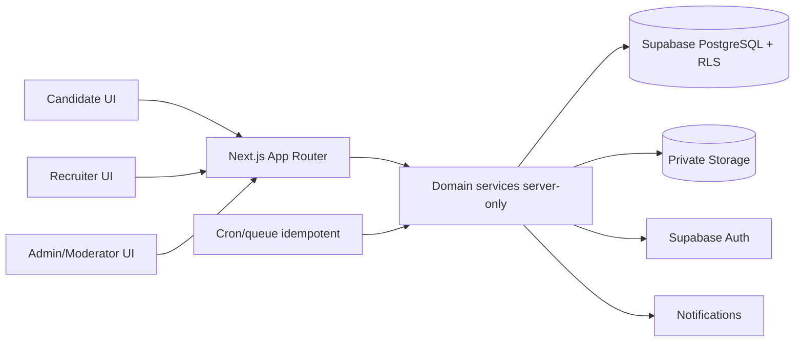

# Kiến trúc V.E.T.T MVP

## Hiện trạng và nguyên tắc

Repo chỉ có C++ Visual Studio; chưa có Next.js, migrations, test hoặc `.env.example`. Đây là thiết kế tương lai, không mô tả hệ thống đã chạy. Chọn modular monolith: một Next.js App Router/TypeScript strict, các feature domain tách thư mục, không tạo microservice. Tailwind CSS + shadcn/ui cho UI tiếng Việt, mobile-first; Zod tại biên server. Supabase Auth, PostgreSQL, private Storage và RLS làm nền. `@supabase/ssr` quản lý session; server actions/route handlers xử lý lệnh nhạy cảm. Không đưa service role hay đáp án test vào bundle/client.

## Sơ đồ thành phần

Feature folders đề xuất: `auth`, `profiles`, `organizations`, `jobs`, `applications`, `tests`, `interviews`, `cv-consent`, `community`, `safety`, `notifications`, `admin`. Shared chỉ chứa UI primitive, DB client, validation và kiểu dùng chung; không đặt quyền truy cập trong component. Mỗi use case server kiểm tra actor, org membership, ownership và trạng thái trước khi ghi. RLS là hàng rào thứ hai, được kiểm bằng token người dùng thật.

## Mô hình dữ liệu khái niệm

Tất cả bảng nghiệp vụ dùng UUID PK, `created_at/updated_at`, FK/index, unique constraint; migration có version. Bảng theo tenant mang `organization_id`; composite FK hoặc constraint/trigger bảo đảm job, application, test, lịch, grant thuộc cùng org. Các khóa unique quan trọng: membership `(organization_id,user_id)`, saved job `(candidate_id,job_id)`, vote `(user_id,target_type,target_id)`, một attempt active theo application/policy, notification dispatch idempotency key.

| Module | Bảng nền | Ranh giới dữ liệu |
| --- | --- | --- |
| Identity/Profile | `profiles`, `candidate_profiles`, `candidate_skills`, `candidate_cv_files`, `candidate_privacy_settings` | Owner cập nhật; public projection không có liên hệ/CV/điểm; discoverable mặc định false. |
| Organization | `organizations`, `organization_members`, `organization_verifications`, `branches` | Membership theo org; bằng chứng ĐKKD private; badge từ verification approved. |
| Jobs/Apply | `jobs`, `job_skills`, `saved_jobs`, `applications` | Job published public; application snapshot chỉ candidate và org sở hữu; saved job chỉ owner. |
| Test | `test_banks`, `test_questions`, `test_attempts`, `test_attempt_questions`, `test_answers`, `test_grades` | Khóa đáp án private; attempt snapshot bất biến; điểm theo org/job. |
| Interview/CV | `recruiter_invitations`, `appointments`, `cv_access_grants`, `notifications` | Grant có candidate, org, job/application, expiry/revoke; đường tải kiểm tra mỗi request. |
| Safety | `incident_reports`, `incident_responses`, `incident_appeals`, `moderation_actions`, `safety_warnings` | Report/evidence private; warning public là bản duyệt riêng. |
| Community | `forum_posts`, `forum_comments`, `forum_votes`, `forum_bookmarks`, `forum_reports` | Public projection dùng pseudonym; author_id nội bộ; soft-delete và moderation. |
| Audit | `audit_logs` | Append-only cho sự kiện quyền, cấp/thu hồi CV, xác minh, moderation, warning. |

**Đề xuất triển khai:** tách public read models/views khỏi bảng gốc để không lộ cột nhạy cảm. Dùng DB transaction cho Apply + attempt, phát test + snapshot, consent + grant, moderation + warning. Khóa/hạn mức ở DB để xử lý retry và chạy đồng thời. Không dựa vào việc ẩn nút trên UI.

## Trạng thái và bất biến

| Đối tượng | Chuyển trạng thái từ nguồn | Bất biến / điểm mở |
| --- | --- | --- |
| Organization | `pending → verified/rejected/suspended` | Chỉ admin cấp verified; luồng tái xác minh Q-08. |
| Job | `draft → pending_review (nếu cần) → published → paused/closed/expired` | Chỉ published hiện public; điều kiện duyệt Q-03. |
| Application | Không test: Apply → application; có test: `test_pending → test_submitted → under_review` | Cần chốt trạng thái sau HR review/withdraw Q-10; không tự loại bằng AI. |
| Attempt | issued → submitted/expired **(đề xuất)** | Snapshot cố định; deadline server; timeout/retry Q-02. |
| Appointment | `proposed → accepted/declined/reschedule_requested/cancelled → completed/no_show_disputed` | Consent CV là luồng độc lập, không là hệ quả accept; quy tắc completed Q-05. |
| CV grant | active → expired/revoked **(đề xuất)** | Chỉ tạo sau accept + consent; TTL Q-04; chặn tải mới sau revoke. |
| Incident | `pending_review → confirmed/rejected/appealed/resolved` | Không xuất bản report; chỉ warning đã duyệt, Q-06/07. |

## Luồng dữ liệu nhạy cảm và phụ thuộc

Auth → profile/org membership → job → application → test (tùy chọn) → invitation/appointment → CV consent/grant. Community độc lập với lõi tuyển dụng, chỉ tham chiếu public organization tag. Safety nhận report từ job, appointment hoặc forum; chỉ moderator/admin xem chứng cứ. Notification dùng event + idempotency key; không gửi khi chưa commit transaction. Cron khảo sát theo `Asia/Ho_Chi_Minh`, lưu UTC.

CV và giấy ĐKKD nằm ở private bucket riêng/prefix có policy owner; server cấp signed URL TTL ngắn sau khi kiểm quyền hiện tại. Không dùng URL public. Tải CV phải audit; thu hồi không thu lại bản đã tải. Kết quả test, liên hệ cá nhân, identity ẩn danh và report không nằm trong search index công khai.

## Kiểm thử kiến trúc

Vitest cho state/validation; DB integration/RLS với token candidate, org A/B, moderator; Playwright cho Apply không test, test có deadline, consent CV, forum official và report private. CI chạy lint, typecheck, unit, migration + RLS và E2E theo milestone. Không dùng dữ liệu mock trên production. Chưa chọn provider queue/email hoặc TTL cố định; xem OPEN_QUESTIONS.
