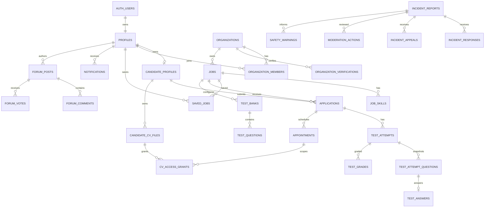

# Thiết kế dữ liệu V.E.T.T — bản đang hoàn thiện

Sơ đồ thể hiện quan hệ dự kiến; chỉ các bảng trong migration thực tế đã được tạo. Không áp dụng migration lên môi trường sản xuất trước khi hoàn thiện RLS và kiểm thử bằng Supabase.

## Ranh giới bảo mật cần thực hiện

- Ràng buộc `(organization_id, job_id)` và `(organization_id, application_id)` bằng composite FK; không chỉ dựa vào client chọn tenant. Membership/role do hệ thống kiểm soát, không cho user tự cấp.
- Private CV và ĐKKD lưu ở private bucket; chỉ cấp quyền tải sau khi kiểm tra membership đúng org, application/job, appointment accepted, consent riêng, expiry và revoke. URL đã ký còn hiệu lực đến khi hết TTL; không cam kết thu hồi URL đã cấp ngay lập tức.
- Tách đáp án chuẩn và điểm khỏi dữ liệu candidate được phép đọc. Server kiểm tra thời hạn, chấm trắc nghiệm, không nhận điểm từ client; phần tự luận do HR chấm.
- Bài community công khai qua projection không chứa author ID, metadata truy vết; official reply được server xác nhận theo verified organization và membership phù hợp. Tố cáo, bằng chứng, strike và appeal private; không tự động công bố warning.
- `SECURITY DEFINER` phải có `search_path` cố định, hạn chế EXECUTE và kiểm actor; mọi bảng bật RLS. Không dùng `service_role` phía client.

## Transaction cần xây dựng

1. Apply: khóa job, xác nhận published và verified email; insert application snapshot và trạng thái tương ứng một lần; không tạo attempt trước khi bắt đầu.
2. Bắt đầu test: khóa application, kiểm số lần theo policy, chọn 3 MCQ từ bank hợp lệ, ghi snapshot và deadline server nguyên tử; không gửi đáp án chuẩn.
3. Nộp/chấm test: khóa attempt, kiểm deadline và idempotency; ghi đáp án, chấm MCQ, cập nhật trạng thái, lưu audit. HR chấm tự luận trong transaction riêng.
4. CV consent: khóa appointment và file, kiểm ứng viên sở hữu, trạng thái accepted, tạo grant có expiry và audit; revoke khóa grant, ghi `revoked_at` và audit.
5. Moderation: khóa report, ghi quyết định và audit; warning chỉ tạo sau ngưỡng xác nhận và quyết định moderator. Q-06/Q-07 còn mở, nên không tự động phát warning.
6. Notification/cron: ghi outbox và event idempotency key trong cùng transaction; worker gửi sau commit, không gửi trùng.

Các câu hỏi Q-01 đến Q-15 trong `OPEN_QUESTIONS.md` vẫn cần được giải quyết trước khi mở các luồng tương ứng.
